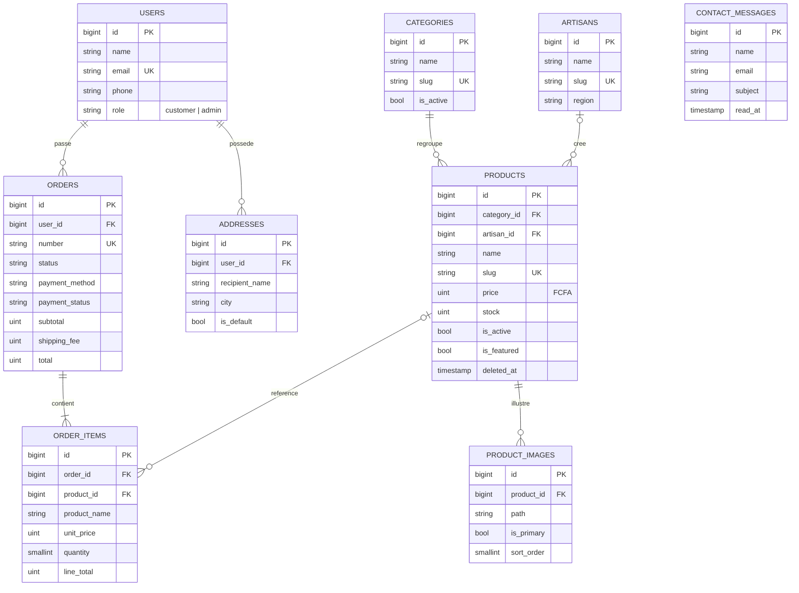

# Afrique Artisanat — Structure du projet Laravel

Projet de démonstration NexaWeb Mali : boutique en ligne d'artisanat africain (Laravel, Bootstrap 5, MySQL, XAMPP).
Ce dossier contient **tout le code applicatif** (migrations, modèles, services, contrôleurs, validation, routes, seeders, tests).
Les **vues Blade (Bootstrap 5)** reprennent les maquettes : 48 vues, 2 gabarits (site et back-office), un thème Sass aux couleurs du cahier des charges et 4 composants de formulaire.

> Boutique, artisans et produits sont fictifs. Aucune vente réelle.

## 1. Installation (Windows + XAMPP)

**Prérequis :** XAMPP (MySQL démarré), PHP en ligne de commande, Composer, Node.js, Git.
Version de PHP : Laravel 12 demande PHP 8.2 ou plus, Laravel 13 demande PHP 8.3 ou plus. Vérifier avec `php -v` ; si PHP < 8.3, choisir Laravel 12.

```bash
# 1. Créer un projet Laravel vierge
composer create-project laravel/laravel afrique-artisanat          # dernière version (Laravel 13, PHP 8.3+)
# composer create-project laravel/laravel:^12.0 afrique-artisanat  # si PHP 8.2
cd afrique-artisanat

# 2. Copier le contenu de ce dossier PAR-DESSUS le projet (accepter le remplacement)
#    Fichiers remplacés : app/Providers/AppServiceProvider.php, database/factories/UserFactory.php,
#    routes/web.php, tests/TestCase.php, vite.config.js (Bootstrap + Sass à la place de Tailwind)
```

**3. Base de données** : dans phpMyAdmin (http://localhost/phpmyadmin), créer `afrique_artisanat` (interclassement `utf8mb4_unicode_ci`).

**4. Fichier `.env`** : adapter ces lignes.

```env
APP_NAME="Afrique Artisanat"
APP_LOCALE=fr
APP_FALLBACK_LOCALE=fr
APP_FAKER_LOCALE=fr_FR

DB_CONNECTION=mysql
DB_HOST=127.0.0.1
DB_PORT=3306
DB_DATABASE=afrique_artisanat
DB_USERNAME=root
DB_PASSWORD=

SESSION_DRIVER=database
MAIL_MAILER=log
```

**5. Alias du middleware `admin`** : dans `bootstrap/app.php`, ajouter dans `withMiddleware` :

```php
->withMiddleware(function (Middleware $middleware): void {
    $middleware->alias([
        'admin' => \App\Http\Middleware\EnsureUserIsAdmin::class,
    ]);
})
```

**6. Bootstrap 5 (Vite + Sass)**

```bash
npm install bootstrap @popperjs/core bootstrap-icons sass
npm uninstall tailwindcss @tailwindcss/vite     # présents dans le projet vierge, inutiles ici (ignorer l'erreur s'ils sont absents)
```

Le fichier `resources/css/app.css` du projet vierge n'est plus utilisé : le style vient de `resources/scss/app.scss`
(palette ocre / indigo / crème / sauge, Playfair Display et Poppins, variables Bootstrap personnalisées).

**7. Commandes**

```bash
npm run dev                     # compile les styles et scripts (laisser tourner dans un terminal ; `npm run build` pour figer)
php artisan storage:link        # liens vers storage/app/public (images téléversées)
php artisan migrate --seed      # crée les tables et les données de démonstration
php artisan test                # lance les tests (extension pdo_sqlite activée dans php.ini)
php artisan serve               # http://127.0.0.1:8000 (dans un second terminal)
```

**Comptes de démonstration** (mot de passe `password`) : `admin@afriqueartisanat.test` (administrateur) et `client@afriqueartisanat.test` (client).

Messages de validation en français : installer le paquet communautaire `laravel-lang/common` (voir sa documentation) ; sans lui, les messages restent en anglais.

## 2. Contenu du dossier

```
├── app
│   ├── Enums
│   │   ├── OrderStatus.php
│   │   ├── PaymentMethod.php
│   │   ├── PaymentStatus.php
│   │   └── UserRole.php
│   ├── Exceptions
│   │   └── CheckoutException.php
│   ├── Http
│   │   ├── Controllers
│   │   │   ├── Account
│   │   │   │   ├── AddressController.php
│   │   │   │   ├── OrderController.php
│   │   │   │   └── ProfileController.php
│   │   │   ├── Admin
│   │   │   │   ├── ArtisanController.php
│   │   │   │   ├── CategoryController.php
│   │   │   │   ├── ContactMessageController.php
│   │   │   │   ├── CustomerController.php
│   │   │   │   ├── DashboardController.php
│   │   │   │   ├── OrderController.php
│   │   │   │   ├── ProductController.php
│   │   │   │   └── ProductImageController.php
│   │   │   ├── Auth
│   │   │   │   ├── LoginController.php
│   │   │   │   └── RegisterController.php
│   │   │   ├── ArtisanController.php
│   │   │   ├── CartController.php
│   │   │   ├── CategoryController.php
│   │   │   ├── CheckoutController.php
│   │   │   ├── ContactController.php
│   │   │   ├── HomeController.php
│   │   │   └── ProductController.php
│   │   ├── Middleware
│   │   │   └── EnsureUserIsAdmin.php
│   │   └── Requests
│   │       ├── Admin
│   │       │   ├── ArtisanRequest.php
│   │       │   ├── CategoryRequest.php
│   │       │   ├── OrderStatusRequest.php
│   │       │   └── ProductRequest.php
│   │       ├── AddressRequest.php
│   │       ├── CartRequest.php
│   │       ├── CheckoutRequest.php
│   │       ├── ContactRequest.php
│   │       ├── LoginRequest.php
│   │       ├── ProfileRequest.php
│   │       └── RegisterRequest.php
│   ├── Mail
│   │   └── OrderConfirmation.php
│   ├── Models
│   │   ├── Concerns
│   │   │   └── HasSlug.php
│   │   ├── Address.php
│   │   ├── Artisan.php
│   │   ├── Category.php
│   │   ├── ContactMessage.php
│   │   ├── Order.php
│   │   ├── OrderItem.php
│   │   ├── Product.php
│   │   ├── ProductImage.php
│   │   └── User.php
│   ├── Policies
│   │   └── OrderPolicy.php
│   ├── Providers
│   │   └── AppServiceProvider.php
│   ├── Services
│   │   ├── Payment
│   │   │   ├── CashOnDeliveryGateway.php
│   │   │   ├── MobileMoneyDemoGateway.php
│   │   │   ├── PaymentGateway.php
│   │   │   ├── PaymentManager.php
│   │   │   └── PaymentResult.php
│   │   ├── CartService.php
│   │   └── OrderService.php
│   └── Support
│       ├── CartItem.php
│       └── Money.php
├── config
│   └── shop.php
├── database
│   ├── factories
│   │   ├── ArtisanFactory.php
│   │   ├── CategoryFactory.php
│   │   ├── ProductFactory.php
│   │   └── UserFactory.php
│   ├── migrations
│   │   ├── 2026_10_18_100000_add_role_and_phone_to_users_table.php
│   │   ├── 2026_10_18_100100_create_categories_table.php
│   │   ├── 2026_10_18_100200_create_artisans_table.php
│   │   ├── 2026_10_18_100300_create_products_table.php
│   │   ├── 2026_10_18_100400_create_product_images_table.php
│   │   ├── 2026_10_18_100500_create_addresses_table.php
│   │   ├── 2026_10_18_100600_create_orders_table.php
│   │   ├── 2026_10_18_100700_create_order_items_table.php
│   │   └── 2026_10_18_100800_create_contact_messages_table.php
│   └── seeders
│       ├── ArtisanSeeder.php
│       ├── CategorySeeder.php
│       ├── DatabaseSeeder.php
│       ├── OrderSeeder.php
│       ├── ProductSeeder.php
│       └── UserSeeder.php
├── public
│   └── images
│       └── placeholder.svg
├── resources
│   ├── js
│   │   └── app.js
│   ├── scss
│   │   └── app.scss
│   └── views
│       ├── account
│       │   ├── orders
│       │   │   ├── index.blade.php
│       │   │   └── show.blade.php
│       │   ├── partials
│       │   │   └── address-form.blade.php
│       │   ├── addresses.blade.php
│       │   └── profile.blade.php
│       ├── admin
│       │   ├── artisans
│       │   │   ├── form.blade.php
│       │   │   └── index.blade.php
│       │   ├── categories
│       │   │   ├── form.blade.php
│       │   │   └── index.blade.php
│       │   ├── customers
│       │   │   └── index.blade.php
│       │   ├── messages
│       │   │   ├── index.blade.php
│       │   │   └── show.blade.php
│       │   ├── orders
│       │   │   ├── index.blade.php
│       │   │   └── show.blade.php
│       │   ├── products
│       │   │   ├── form.blade.php
│       │   │   └── index.blade.php
│       │   └── dashboard.blade.php
│       ├── artisans
│       │   ├── index.blade.php
│       │   └── show.blade.php
│       ├── auth
│       │   ├── login.blade.php
│       │   └── register.blade.php
│       ├── cart
│       │   └── index.blade.php
│       ├── categories
│       │   └── show.blade.php
│       ├── checkout
│       │   └── create.blade.php
│       ├── components
│       │   ├── check.blade.php
│       │   ├── input.blade.php
│       │   ├── select.blade.php
│       │   └── textarea.blade.php
│       ├── emails
│       │   └── order-confirmation.blade.php
│       ├── errors
│       │   ├── 403.blade.php
│       │   └── 404.blade.php
│       ├── layouts
│       │   ├── account.blade.php
│       │   ├── admin.blade.php
│       │   ├── app.blade.php
│       │   └── legal.blade.php
│       ├── pages
│       │   ├── legal.blade.php
│       │   ├── privacy.blade.php
│       │   └── terms.blade.php
│       ├── partials
│       │   ├── breadcrumb.blade.php
│       │   ├── flash.blade.php
│       │   ├── footer.blade.php
│       │   ├── header.blade.php
│       │   ├── logo.blade.php
│       │   └── product-card.blade.php
│       ├── products
│       │   ├── index.blade.php
│       │   └── show.blade.php
│       ├── contact.blade.php
│       └── home.blade.php
├── routes
│   └── web.php
├── tests
│   ├── Feature
│   │   ├── AdminAccessTest.php
│   │   ├── CartTest.php
│   │   ├── CheckoutTest.php
│   │   ├── OrderStatusTest.php
│   │   └── PagesTest.php
│   └── TestCase.php
├── README.md
└── vite.config.js
```

## 3. Base de données (9 tables + tables standard de Laravel)



Choix de conception :
- **Montants en entiers** (le FCFA n'a pas de décimales) : pas d'erreurs d'arrondi.
- **`order_items` copie le nom et le prix** du produit au moment de l'achat, et **`orders` copie l'adresse de livraison** : l'historique reste exact si le catalogue ou le carnet d'adresses change.
- **Produits en suppression logique** (`deleted_at`) : un produit retiré du site reste visible dans les anciennes commandes.
- **Slugs** générés automatiquement (trait `HasSlug`) pour des URL lisibles : `/produits/pagne-bogolan-ocre-et-indigo`.

## 4. Règles métier implémentées

| Domaine | Règle |
|---|---|
| Panier | Stocké en session (`id produit => quantité`). Prix et stock relus en base à chaque affichage. Quantité plafonnée par le stock et par `shop.max_quantity_per_line`. |
| Livraison | Forfait `shop.shipping_fee` (2 000 FCFA), offert dès `shop.free_shipping_threshold` (50 000 FCFA). Valeurs de démonstration, modifiables dans `config/shop.php` ou `.env`. |
| Commande | Compte client obligatoire. Transaction SQL : verrouillage des produits, contrôle du stock, création de la commande et des lignes, décrément du stock. En cas de stock insuffisant, rien n'est enregistré. |
| Paiement | Passerelles simulées : paiement à la livraison (reste « à payer ») ; Orange Money / Moov Money (démo) : accepté d'office avec une référence fictive `DEMO-…`. Pour un vrai paiement (V2), ajouter une classe qui implémente `PaymentGateway`. |
| Statuts | En attente → Confirmée → Expédiée → Livrée. Annulation possible seulement avant expédition. Livrée et Annulée sont finales. |
| Annulation | Le stock est remis en vente. Les remboursements Mobile Money ne sont pas gérés (démo). |
| Livraison effectuée | Un paiement à la livraison « à payer » passe à « payée ». |
| Rôles | `customer` par défaut ; `admin` ne peut pas être attribué par un formulaire (hors `$fillable`). Le back-office est protégé par les middlewares `auth` et `admin`. |
| Sécurité | CSRF (formulaires Laravel), validation par Form Requests, mots de passe hachés, limitation des tentatives (connexion, contact), champ anti-robot sur le contact, policy `OrderPolicy` (un client ne voit que ses commandes). |
| E-mail | Confirmation de commande (`MAIL_MAILER=log` : le message s'écrit dans `storage/logs/laravel.log`). Un échec d'envoi n'annule jamais la commande. |

## 5. Vues Blade fournies (maquette → vue)

Layouts : `layouts/app` (site), `layouts/admin` (back-office), `layouts/account` (espace client), `layouts/legal` (pages légales).
Partiels : `partials/header`, `footer`, `flash`, `logo`, `breadcrumb`, `product-card`.
Composants : `<x-input>`, `<x-textarea>`, `<x-select>`, `<x-check>` (libellés, erreurs de validation et anciennes valeurs gérés).
Directive utile : `@money($montant)` affiche `28 000 FCFA`.

| Maquette | Vue Blade | Route |
|---|---|---|
| Accueil | `home` | `home` |
| Catalogue | `products/index` | `products.index` |
| Fiche produit | `products/show` | `products.show` |
| (catégorie) | `categories/show` | `categories.show` |
| Artisans / Fiche artisan | `artisans/index`, `artisans/show` | `artisans.*` |
| Panier | `cart/index` | `cart.index` |
| Commande | `checkout/create` | `checkout.create` |
| Contact | `contact` | `contact.create` |
| Mentions légales / CGV / Confidentialité | `pages/legal`, `pages/terms`, `pages/privacy` | `pages.*` |
| Connexion / Inscription | `auth/login`, `auth/register` | `login`, `register` |
| Mes commandes / Détail d'une commande | `account/orders/index`, `account/orders/show` | `account.orders.*` |
| Mon compte (profil et adresses) | `account/profile`, `account/addresses` | `account.profile.edit`, `account.addresses.index` |
| Back-office : tableau de bord | `admin/dashboard` | `admin.dashboard` |
| Back-office : produits, fiche produit | `admin/products/index`, `admin/products/form` | `admin.products.*` |
| Back-office : catégories | `admin/categories/index`, `admin/categories/form` | `admin.categories.*` |
| Back-office : artisans | `admin/artisans/index`, `admin/artisans/form` | `admin.artisans.*` |
| Back-office : commandes, détail | `admin/orders/index`, `admin/orders/show` | `admin.orders.*` |
| Back-office : clients | `admin/customers/index` | `admin.customers.index` |
| Back-office : messages | `admin/messages/index`, `admin/messages/show` | `admin.messages.*` |
| (pages d'erreur) | `errors/403`, `errors/404` | |

Les formulaires de catégorie, d'artisan, de message et la page d'erreur n'ont pas de maquette dédiée : ils reprennent les mêmes motifs que le formulaire produit.
Messages flash disponibles : `success`, `error`, `warning`.

## 6. Limites connues

- Code et vues **non exécutés dans Laravel** à la livraison : la syntaxe PHP, l'équilibre des directives Blade, les routes et les vues référencées ont été contrôlés automatiquement, et la logique des enums et des montants a été testée.
  `php artisan test` lance 5 groupes de tests, dont `PagesTest` qui affiche chaque page : s'il signale une erreur, le message indique la vue et la ligne concernées.
- Les maquettes montrent un rendu sur mesure ; les vues utilisent les composants Bootstrap personnalisés : de petits écarts visuels sont normaux et se règlent dans `resources/scss/app.scss`.
- Les images de démonstration pointent toutes vers `public/images/placeholder.svg`. Les images téléversées par l'admin vont dans `storage/app/public`.
- Pas de réinitialisation de mot de passe ni de vérification d'e-mail (hors périmètre V1 du cahier des charges).
